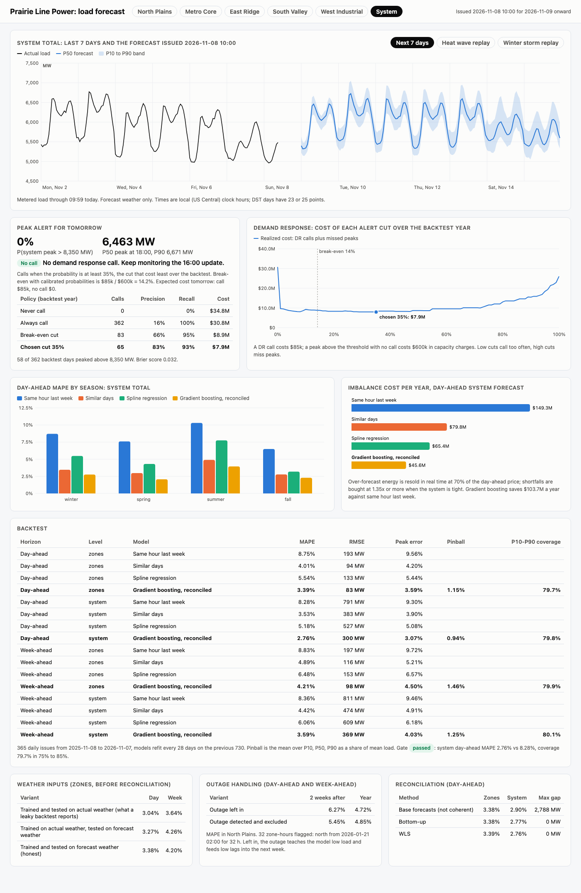
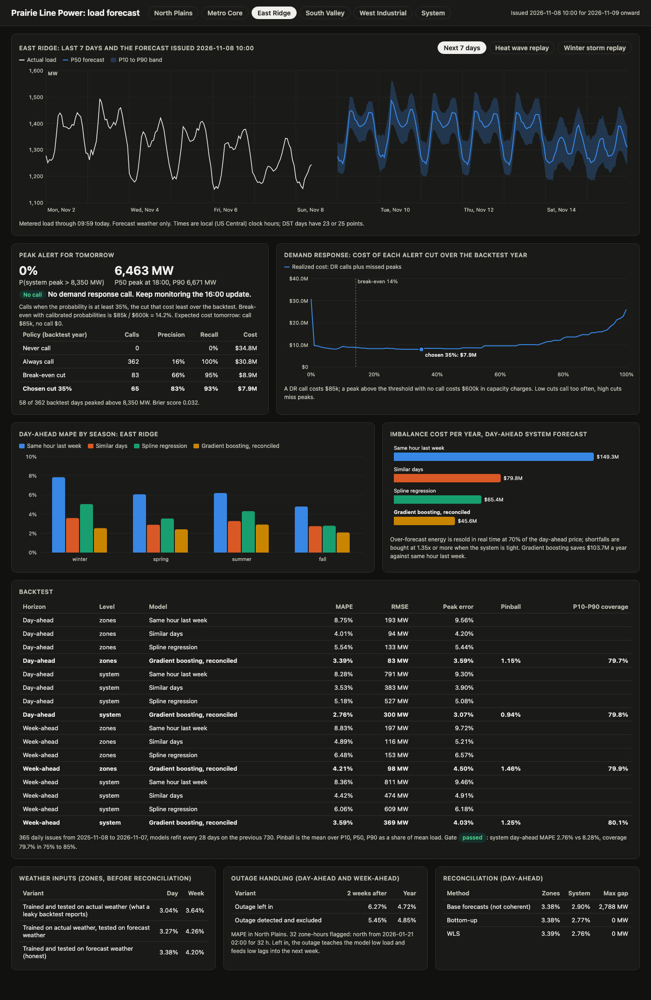

# Grid load forecast

Day-ahead and week-ahead electricity load forecasting for Prairie Line Power, a made-up utility with five load zones and a 6 to 13 GW system. It generates four years of hourly load driven by weather, the calendar, daylight saving time, school terms, a growing data center, and rooftop solar, plus a heat wave and a winter storm with an outage. It forecasts every zone and the system total with P10, P50, and P90, backtests honestly on the weather forecast that existed at 10:00 each morning, decides whether to call a demand response event for tomorrow's peak, and turns forecast error into dollars. A FastAPI service serves all of it with a web UI.



**Backtest**: 365 daily forecasts issued at 10:00 from 2025-11-08 to 2026-11-07, models refit every 28 days on the previous two years, forecast weather only:

| Horizon | Level | Model | MAPE | RMSE | Peak error | Pinball | P10-P90 coverage |
|---|---|---|---:|---:|---:|---:|---:|
| Day-ahead | 5 zones | Same hour last week | 8.75% | 193 MW | 9.56% | | |
| Day-ahead | 5 zones | Similar days | 4.01% | 94 MW | 4.20% | | |
| Day-ahead | 5 zones | Spline regression | 5.54% | 133 MW | 5.44% | | |
| Day-ahead | 5 zones | **Gradient boosting, reconciled** | **3.39%** | **83 MW** | **3.59%** | 1.15% | 79.7% |
| Day-ahead | System | Same hour last week | 8.28% | 791 MW | 9.30% | | |
| Day-ahead | System | Similar days | 3.53% | 383 MW | 3.90% | | |
| Day-ahead | System | Spline regression | 5.18% | 527 MW | 5.08% | | |
| Day-ahead | System | **Gradient boosting, reconciled** | **2.76%** | **300 MW** | **3.07%** | 0.94% | 79.8% |
| Week-ahead | 5 zones | Same hour last week | 8.83% | 197 MW | 9.72% | | |
| Week-ahead | 5 zones | **Gradient boosting, reconciled** | **4.21%** | **98 MW** | **4.50%** | 1.46% | 79.9% |
| Week-ahead | System | Same hour last week | 8.36% | 811 MW | 9.46% | | |
| Week-ahead | System | **Gradient boosting, reconciled** | **3.59%** | **369 MW** | **4.03%** | 1.25% | 80.1% |

Pinball is the mean over P10, P50, and P90 as a share of mean load. Peak error is the absolute error of each day's peak. By season, system day-ahead MAPE is 2.8% in winter, 2.1% in spring, 4.0% in summer, and 2.3% in fall (same hour last week: 8.7%, 7.6%, 10.3%, 6.5%). On the 37 extreme days (top 10% of peaks plus the heat wave and storm) it is 4.9% with 75% coverage, against 13.8% for same hour last week.

**What forecast error costs**, day-ahead system forecast over the backtest year:

| Model | Over-forecast | Under-forecast | Imbalance cost per year |
|---|---:|---:|---:|
| Same hour last week | $33.6M | $115.7M | $149.3M |
| Similar days | $9.4M | $70.4M | $79.8M |
| Spline regression | $33.0M | $32.4M | $65.4M |
| **Gradient boosting, reconciled** | $16.0M | $29.7M | **$45.6M** |

The model cuts imbalance cost by $103.7M a year against same hour last week. Similar days has a lower MAPE than spline regression but costs more, because it under-forecasts hot days, when real-time power is scarce and a shortfall is expensive.

**Peak alerts**: the demand response trigger is 8,350 MW, exceeded on 58 of 362 backtest days. A call costs $85k and a missed peak $600k, so the break-even probability is 14.2%. Calling whenever the forecast probability is at least 35% (the cut with the lowest realized cost) catches 54 of 58 peaks with 83% precision for $7.9M, against $34.8M for never calling and $30.8M for always calling.

## Why

A utility buys most of tomorrow's power in the day-ahead market, so the forecast it makes at 10:00 is a purchase order. Every megawatt-hour it misses is bought later at real-time prices, and every one too many is sold back at a loss. On the hottest afternoons the same forecast also decides whether to pay customers to cut load, because an unshaved peak can set the capacity bill for a whole year. Planners often start from last week's load and a weather adjustment. That works on mild days and fails on the days that cost money: heat waves, cold snaps, holidays, and the hours around a DST change. This repo is a small working version of a forecast desk: honest backtests on forecast weather, calibrated bands, and decisions priced in dollars.

## Architecture

```
 generator (seeded)                 forecasting                                   decisions
 ┌──────────────────────────┐    ┌──────────────────────────────────────────┐   ┌───────────────────────────────┐
 │ 5 zones x 1,461 days x   │    │ outage detection: trailing median,       │   │ peak alert: P(peak > 8,350    │
 │ 24 local hour slots      │    │   dark-hour rule, impute and exclude     │   │   MW) from past peak errors,  │
 │ temperature U-shape,     │──▶ │ features at issue time: lags metered     │──▶│   cut chosen on realized cost │
 │ humidity, holidays,      │    │   before 10:00, forecast weather, analog │   │ imbalance cost: DA price,     │
 │ bridge days, DST, school │    │ models: last week, similar days, spline  │   │   RT resale and scarcity      │
 │ data center, solar,      │    │   ridge, pooled GBM, quantile GBM        │   │                               │
 │ heat wave, storm outage  │    │ WLS reconciliation, conformal (CQR) band │   │                               │
 │ forecast archive 0-7 d   │    │ rolling-origin backtest and gate         │   │                               │
 └──────────────────────────┘    └──────────────────────────────────────────┘   └──────────────┬────────────────┘
                                                                                               ▼
                                        data/artifacts.json ──▶ FastAPI: /api/*, /healthz, /metrics, JSON logs, UI at /
```

| Piece | File |
|---|---|
| Holidays, bridge days, school terms, DST hours | `src/gridload/calendar.py` |
| Synthetic load, weather, and the forecast archive | `src/gridload/generator.py` |
| Outage detection and cleaning | `src/gridload/anomaly.py` |
| Leakage-safe features and node data | `src/gridload/features.py` |
| Baselines, spline regression, GBM, quantile GBM | `src/gridload/models.py` |
| Reconciliation | `src/gridload/reconcile.py` |
| Conformalized quantile bands | `src/gridload/conformal.py` |
| Metrics (MAPE, RMSE, peak error, pinball, coverage) | `src/gridload/scoring.py` |
| Rolling-origin backtest, gate | `src/gridload/backtest.py` |
| Peak alerts and the cost tradeoff | `src/gridload/alerts.py` |
| Imbalance cost | `src/gridload/economics.py` |
| End to end pipeline and live forecast | `src/gridload/pipeline.py` |
| API, metrics, logs, UI | `src/gridload/app.py`, `prom.py`, `logs.py`, `static/index.html` |

How each piece works:

- **Synthetic data.** Five zones from 640 to 1,720 MW of base load: a cold rural north, a dense metro, East Ridge with a data center growing from 120 to 600 MW in six-month steps, a hot suburban south with the most rooftop solar, and a flat industrial west. Heating load grows as `(16 C - T)^1.3` and cooling as `(T - 20 C)^1.5`, scaled up by humidity, which gives the U-shape. Weekday, Saturday, and Sunday profiles follow the local clock; holidays use the Sunday shape at 95%, and bridge days (the Friday after Thanksgiving, Christmas Eve) sit between a weekday and a Saturday. Schools add load from 07:00 to 15:00 in term. Rooftop solar grows from 270 to 1,135 MW and follows standard time, so its peak moves an hour later on the local clock in summer. A July heat wave adds up to 8 C for a week. A January storm takes 14 C off for five days, and North Plains loses 70% of its load for 34 hours.
- **Daylight saving.** Everything is modeled on a grid of 24 local hour slots per day. A weight per slot says how many real hours it holds: 0 for the 02:00 that does not exist in spring, 2 for the repeated 01:00 in fall. Metrics and dollars use the weights, and the API expands forecasts to real clock hours with UTC offsets (23 or 25 points on those days).
- **Weather forecasts and leakage.** The archive holds, for each 10:00 issue, the forecast for each of the next 7 days. Temperature error grows from 1.1 C at day 1 to 3.1 C at day 7 and is correlated across hours and zones. A forecast for day `t` issued on day `i` comes from `forecast_weather(ds, i, t)`, which refuses any lead outside 0 to 7 days. Lags use only load metered before 10:00 on the issue day (same hour last week steps back another week when that hour is not metered yet). A test perturbs every load value after the cutoff and every actual weather value from the issue day on, and checks that the features do not change.
- **Models.** Same hour last week. Similar days: the 3 recent days of the same day type whose temperature was closest to the target's forecast. Spline regression: ridge per node on a cubic temperature spline, hour by day type, month, school, solar, and humidity. Gradient boosting: one `HistGradientBoostingRegressor` pooled over the five zones and the system, with weather, calendar, lags, lead time, and the similar-days forecast as a feature. The target is load divided by the node's mean over the last 168 metered hours, so one model serves 640 MW and 6 GW nodes and growth moves the scale, not the trees. P10 and P90 come from quantile gradient boosting.
- **Weather inputs compared.** Training and testing on actual weather reports 3.04% day-ahead MAPE (zones), which no one can achieve, because tomorrow's actual weather is not known. Training on actuals and testing on forecasts gives 3.27%. Training and testing on the forecast archive gives 3.38%. Day-ahead the two honest options are close; week-ahead, training on forecast weather is slightly better (4.20% vs 4.26%), since the model learns how much to trust a 6-day-old forecast.
- **Reconciliation.** Zone and system forecasts are made coherent with WLS (MinT with a diagonal covariance from warm-up errors). Base forecasts disagree by up to 2,788 MW; after WLS they add up exactly, and system MAPE drops from 2.90% to 2.76% while zone MAPE stays at 3.39%.
- **Intervals.** The quantile band is shifted with the reconciled median, then widened or narrowed by conformalized quantile regression: per lead bucket (day 1, days 2 to 7) and level (zones, system), using only past forecasts whose target day has been metered. Coverage lands at 79.7% to 80.1% against an 80% target.
- **Outage handling.** A cell is anomalous when load falls below 55% of the same hour's median over the previous 14 days for 4+ hours, and the run includes at least 2 dark hours (a sunny holiday afternoon with rooftop solar can look like a drop, a night cannot). The 4 restoration hours after a run are flagged too. It finds 32 of the 34 outage hours and nothing else in four years. Flagged cells are imputed for lags, dropped as training targets, and left out of scoring. In the two weeks after the outage, North Plains MAPE is 5.45% with handling and 6.27% without; over the full year the two are within 0.13 points.
- **Peak alerts.** The probability that tomorrow's system peak exceeds the trigger comes from the forecast peak times the last 120 days of peak errors, `exp(log(actual / forecast))`. Each backtest day records the probability, the cost curve sums calls and misses for every cut from 0% to 100%, and the service uses the cut with the lowest realized cost. That cut (35%) is above the 14.2% break-even because the probabilities are a little underconfident (Brier score 0.032).
- **Imbalance cost.** Day-ahead price is `24 + 70 * (load / 9,000 MW)^4` $/MWh. Over-forecast energy is resold in real time at 70% of day-ahead. Shortfalls are bought at 1.35 times day-ahead, plus 4 times for every unit of load above 90% of 9,000 MW.



## How to run

Requires [uv](https://docs.astral.sh/uv/). Docker is optional and not needed to run anything here.

```bash
make install           # uv sync --python 3.12
make train             # four years, 365-day backtest, 16 refits: about 3 minutes, writes data/artifacts.json
make run               # API and UI on http://127.0.0.1:8856
```

Other commands:

```bash
uv run gridload train --quick                   # 820 days, 300-day backtest, about 20 seconds
uv run gridload backtest --quick --gate         # what CI runs; exits 1 if the gate fails
uv run gridload backtest --json data/bt.json    # full backtest only

curl "localhost:8856/api/forecast?zone=metro&horizon=day"     # tomorrow, P10/P50/P90 by hour
curl "localhost:8856/api/forecast?zone=system&horizon=week"   # next 7 days plus the last 7 days of actuals
curl localhost:8856/api/peak-alert                            # probability, recommended action, cost curve
curl "localhost:8856/api/backtest?zone=south"                 # tables, by season for one zone
curl localhost:8856/api/economics
curl "localhost:8856/api/replay?kind=winter_storm&zone=north"
curl localhost:8856/metrics
```

Other endpoints: `/api/zones`, `/healthz`. Logs are one JSON object per line with a request id, echoed in the `x-request-id` header. If `data/artifacts.json` is missing, the service builds the quick version on startup.

With Docker: `make docker-build && make docker-run`. The container trains the quick version on first start (about 20 seconds) if its data directory is empty. The image is built and smoke tested in CI, not on this machine.

Screenshots: with the server running, `make screenshot` drives headless Chrome to write the images in `docs/`.

## Tests

```bash
uv run pytest -q       # 90 tests, about 30 seconds
uvx ruff check .
```

- Generator (16): shapes, same seed same data, temperature U-shape (cold and hot days both 20%+ above mild), holidays below nearby weekdays, the Friday after Thanksgiving below ordinary Fridays, holiday and bridge calendar, DST weights (23 and 25 hours, 8 transition days in four years), DST days expand to 23 and 25 unique timestamps, solar peaks an hour later on the clock in summer, solar and data center growth, outage ground truth, heat wave and storm temperatures, forecast error grows with lead time, issue-day hours before 10:00 are observed, school calendar.
- Features and leakage (12): the weather guard refuses forecasts not yet issued, bad leads and early issues rejected, **perturbing the future leaves every feature unchanged**, actual-weather mode differs, same hour last week steps back when unmetered, latest metered hour, the 168-hour scale, the system node sums the zones, training pairs stay in range, flagged and unmetered targets excluded, similar days only look back, feature list.
- Models (7): each model on a 150-day dataset, spline regression learns the U-shape, GBM beats last week, quantile band ordering and coverage, determinism.
- Scoring and intervals (8): MAPE, RMSE, bias, pinball, coverage, and peak error by hand, DST weights, conformal finite-sample quantile, CQR reaches 80% from a band that was too narrow, CQR uses only past scores.
- Reconciliation (6): summing matrix, every method coherent, bottom-up, coherent input unchanged, OLS splits a gap evenly, WLS follows the low-variance node.
- Outage handling (6): run length and padding, daylight-only dips ignored, trailing median never looks ahead, the detector finds exactly the outage in four years, imputation, run summary.
- Alerts (6): exceedance probability, realized cost by hand, never calling, break-even, **threshold optimization on a hand-worked example** (best cut 21% at $20), curve grid.
- Economics (5): a perfect forecast costs zero, over- and under-forecast cost by hand, the repeated fall hour counts twice, shortfalls cost more than surpluses.
- Backtest (11): gate, GBM beats every baseline at both horizons and levels, coverage in band, a losing model fails the gate, week-ahead is harder, outage exclusion helps after the outage, perfect weather flatters the backtest, reconciled forecasts add up, better forecasts cost less, alerts beat never and always calling, season and extreme-day breakdowns.
- API (13): health, metrics, UI, zones, quantiles by zone, day-ahead is tomorrow only, zones sum to the system, 400 and 404, backtest zone filter, peak alert, economics, the replay marks the outage, request id and JSON logs.

CI (`.github/workflows/ci.yml`) runs lint and tests, a **backtest gate** job that fails the build unless gradient boosting's day-ahead system MAPE beats same hour last week and its zone P10 to P90 coverage is between 75% and 85% (it writes the tables to `$GITHUB_STEP_SUMMARY` and uploads the JSON), and a Docker job that builds the image and smoke tests the API. `.github/workflows/nightly.yml` is the retrain job: a cron at 09:00 UTC runs the full gate, retrains, and uploads the artifacts.

## Production notes

- Meter data arrives late and gets revised. The 10:00 forecast would run on preliminary SCADA totals, and the backtest would replay the data as it stood each morning (vintages), not the settled values.
- The weather archive would come from a vendor's stored forecasts at each issue time, for several weather stations per zone, with ensemble members feeding the quantile models directly.
- Behind-the-meter solar would be estimated from satellite irradiance and inverter telemetry instead of a cloud index, and the data center would be modeled from its interconnection schedule, since a new hall shows up as a step no lag can predict.
- Retraining would run nightly from the scheduled workflow, store each model and backtest in object storage, and promote a model only after it passes the gate. Live MAPE and coverage would be tracked and alert when they drift.
- Demand response calls would also respect program rules (notice periods, a cap on events per season), which turns the alert into a small optimization over the season instead of a daily threshold.

## License

MIT. See [LICENSE](LICENSE).
